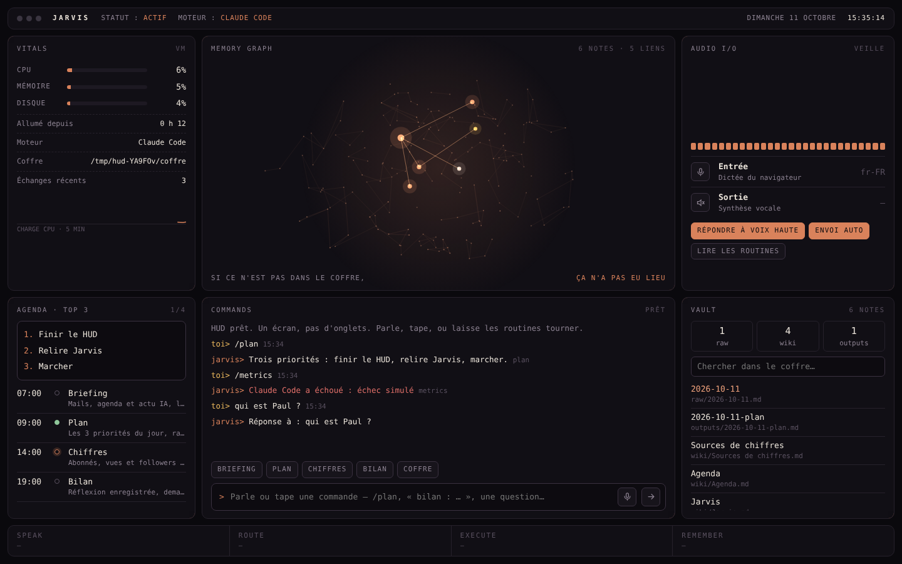

# Jarvis OS — les 4 pièces

> Une voix. Tout ton flux. Zéro onglet.

| Pièce | Rôle | Où |
|---|---|---|
| **Claude Code** | Le moteur. Route chaque demande vers la bonne skill. | `.claude/skills/` |
| **Obsidian** | La mémoire. Tout est du Markdown lié. | `vault/` |
| **Dun** | La voix. Ce que tu dis devient du texte sur l'iPhone. | clavier iPhone |
| **Le HUD** | Le visage. Un écran : vitals, agenda, commandes. | `hud/` |

Chaque pièce se remplace sans toucher aux autres : le moteur peut être
Ollama (`--engine ollama`), le coffre n'importe quel dossier Obsidian
(`JARVIS_VAULT`), la voix n'importe quel clavier de dictée.

---

## Étape 1 — Le cerveau (fait)

Claude Code + un dossier de skills. Chaque skill est un `SKILL.md` chargé
seulement quand il sert. **Règle : une skill, un rôle.**

| Skill | Rôle | Écrit |
|---|---|---|
| `inbox` | briefing du matin : mails, agenda, actu IA | `outputs/<date>-inbox.md` |
| `plan` | les 3 priorités du jour | `outputs/<date>-plan.md` |
| `metrics` | relève tes chiffres (abonnés, vues…) | `raw/metrics.md` + `outputs/<date>-metrics.md` |
| `vault` | lit et écrit la mémoire | `wiki/*.md` |
| `wrap` | bilan du soir, prépare demain | `outputs/<date>-wrap.md` |

Dans n'importe quelle session Claude Code ouverte dans ce dépôt :
`/plan`, `/wrap fini la maquette`, ou simplement « qu'est-ce que je dois
faire aujourd'hui ? » — Claude choisit la skill d'après sa description.

**Ce que les skills ne font pas toutes seules** : lire tes mails et ton
agenda demande un connecteur branché dans Claude Code (Gmail, Google
Calendar…). Sans lui, `inbox` écrit « Mails : non connectés » — il
n'invente rien. Pareil pour `metrics` : remplis
`vault/wiki/Sources de chiffres.md`, et un chiffre illisible est noté
`non lu`, jamais estimé.

## Étape 2 — La mémoire (fait)

```
vault/
  raw/       captures brutes, ajout seulement
  wiki/      notes liées par [[liens]]
  outputs/   briefings, plans, bilans
```

Ouvre `vault/` dans Obsidian (« Ouvrir un dossier comme coffre ») : la vue
Graphe montre les mêmes liens que le HUD. Le contenu du coffre n'est
**jamais** envoyé sur GitHub (dépôt public) — voir `vault/README.md`.

## Étape 3 — Dun (à toi, 2 minutes)

Dun est un clavier iPhone : tu parles, il tape. Ta voix reste sur
l'iPhone, pas de compte, et il marche partout où tu écris.

1. Installe **Dun** depuis l'App Store.
2. Réglages → Général → Clavier → Claviers → **Ajouter un clavier** → Dun.
3. Dans n'importe quel champ (Mob, Claude, le HUD), touche 🌐 pour passer
   au clavier Dun, et parle.

Dun n'est pas branché à Jarvis : il produit du texte, c'est tout. Les
réponses parlées viennent d'ailleurs — la synthèse vocale du HUD, ou
celle de Mob (bouton 🔊).

Je ne peux pas l'installer à ta place : c'est une app sur ton téléphone.

## Étape 4 — Le visage (fait)

Sur le Mac, dans ce dépôt :

```
python3 hud/server.py
```

puis ouvre **http://127.0.0.1:7777**. Python 3.9+ et Claude Code installé
(`claude` dans le terminal) ; rien d'autre.



Un seul écran, pas d'onglets :

- **Vitals** — CPU, mémoire, disque, batterie, et la charge des 5 dernières minutes.
- **Memory graph** — chaque point brillant est une note du coffre, chaque
  trait un `[[lien]]`. Clique un point pour lire la note. (Le nuage pâle
  autour est décoratif.)
- **Audio I/O** — 🎙 ou la barre d'espace pour dicter (Chrome ou Safari),
  niveau réel du micro, réponses lues à voix haute si tu l'actives.
- **Agenda · top 3** — la journée type et tes 3 priorités, lues dans le plan du jour.
- **Commands** — tape ou dicte ; Briefing / Plan / Chiffres / Bilan en un clic.
- **Vault** — recherche et lecture du coffre, liens cliquables.
- **Speak → Route → Execute → Remember** — chaque commande allume les
  quatre étapes ; tout échange finit dans le journal du jour.

### Une vraie journée, sans rien toucher

Tant que le HUD tourne, il lance seul chaque routine dans sa fenêtre :

| Heure | Routine |
|---|---|
| 07:00 | « Briefing. » Mails, agenda et actu IA — lus à voix haute si « Lire les routines » est actif |
| 09:00 | « Plan. » Tes 3 priorités rangées dans le coffre |
| 14:00 | « Chiffres. » Abonnés, vues, followers consignés |
| 19:00 | « Bilan. » Réflexion enregistrée, demain planifié |

Une routine ne tourne qu'une fois par jour et seulement dans sa fenêtre :
ouvrir le HUD à 10 h lance le plan, pas le briefing de 7 h déjà périmé.
`--no-auto` les coupe.

Pour qu'il démarre avec le Mac (non testé sur un Mac réel — il n'y en a
pas dans le conteneur où ce code a été écrit) :

```
mkdir -p ~/Library/LaunchAgents
cat > ~/Library/LaunchAgents/os.jarvis.hud.plist <<PLIST
<?xml version="1.0" encoding="UTF-8"?>
<!DOCTYPE plist PUBLIC "-//Apple//DTD PLIST 1.0//EN" "http://www.apple.com/DTDs/PropertyList-1.0.dtd">
<plist version="1.0"><dict>
  <key>Label</key><string>os.jarvis.hud</string>
  <key>ProgramArguments</key><array>
    <string>/usr/bin/python3</string><string>$PWD/hud/server.py</string><string>--partage</string>
  </array>
  <key>EnvironmentVariables</key><dict>
    <key>PATH</key><string>$(dirname "$(which claude)"):/usr/bin:/bin</string>
  </dict>
  <key>RunAtLoad</key><true/><key>KeepAlive</key><true/>
</dict></plist>
PLIST
launchctl load ~/Library/LaunchAgents/os.jarvis.hud.plist
```

(À lancer depuis la racine du dépôt : `$PWD` y devient le bon chemin.
Retire la ligne `--partage` si Jarvis doit rester réservé au Mac.)

## Sur ton téléphone et tes autres ordinateurs

Le Mac reste le cerveau : Claude Code et le coffre y vivent. Les autres
appareils affichent **le même** Jarvis — même mémoire, même historique,
mêmes routines — dans leur navigateur.

**1. Sur le Mac**, lance Jarvis en mode partage :

```
python3 hud/server.py --partage
```

macOS demande s'il faut « accepter les connexions entrantes » pour
python3 : **Autoriser**. Le terminal affiche les adresses du Mac, par
exemple `http://MacBook-Air.local:7777/`.

**2. Dans le HUD du Mac**, panneau Vitals → **Appareils · connecter**.
Un code à 6 chiffres s'affiche, avec les adresses à ouvrir.

**3. Sur le téléphone ou l'autre ordinateur** (même Wi-Fi), ouvre une de
ces adresses dans le navigateur, et tape le code. C'est fait, une fois
pour toutes : l'appareil reste connecté.

**4. Sur l'iPhone**, Partager → **Sur l'écran d'accueil** : Jarvis a son
icône et s'ouvre en plein écran, comme une app.

Pour **retirer** un appareil (téléphone perdu, PC prêté) : même panneau,
bouton **Retirer**. Il retombe aussitôt sur l'écran de code.

### Hors de chez toi

Le Wi-Fi de la maison ne suffit plus dès que tu sors. La voie simple et
gratuite : **[Tailscale](https://tailscale.com)**, un réseau privé entre
tes appareils.

1. Installe Tailscale sur le Mac et sur le téléphone, même compte.
2. Relance `python3 hud/server.py --partage` : une adresse en `100.x.x.x`
   s'ajoute à la liste. Elle marche partout, 4G comprise, et le trafic
   est chiffré.

Bonus : `tailscale serve --bg 7777` sur le Mac donne une adresse
**https://** (activer HTTPS dans la console Tailscale si demandé). En
HTTPS, le micro du navigateur fonctionne aussi sur le téléphone. *Non
testé ici : pas de Tailscale dans le conteneur où ce code a été écrit.*

### Ce qu'il faut savoir

- **Le Mac doit être allumé et éveillé.** Pour l'empêcher de dormir tant
  que Jarvis tourne : `caffeinate -i python3 hud/server.py --partage`.
- **Le micro du navigateur exige HTTPS.** Sur une adresse `http://` du
  Wi-Fi, le téléphone refuse le micro : dicte avec le clavier (Dun, ou le
  🎤 du clavier iOS). Le HUD le dit au lieu d'échouer en silence. La
  lecture à voix haute, elle, marche partout.
- **En `http://`, le Wi-Fi transporte tout en clair** sur le réseau local.
  Chez toi, ça va ; sur un Wi-Fi public, passe par Tailscale.
- **Un autre ordinateur peut aussi faire tourner son propre Jarvis**
  (Windows, Linux : Python 3.9+ et Claude Code suffisent). Mais il aura
  sa propre mémoire, sauf à partager le coffre (dossier synchronisé,
  `JARVIS_VAULT`). Le plus simple reste un seul cerveau : le Mac.

### Réglages

| Variable / option | Défaut | Rôle |
|---|---|---|
| `--port` / `JARVIS_HUD_PORT` | `7777` | port local |
| `--vault` / `JARVIS_VAULT` | `vault/` | n'importe quel coffre Obsidian |
| `--engine` / `JARVIS_ENGINE` | `claude` | `ollama` pour du 100 % local |
| `--partage` / `JARVIS_HUD_SHARE=1` | non | ouvre le HUD aux appareils appairés |
| `--home` / `JARVIS_HOME` | `~/.jarvis` | où ranger la liste des appareils |
| `JARVIS_ALLOWED_TOOLS` | `Read,Write,Edit,Glob,Grep,WebSearch,WebFetch` | outils accordés à Claude |
| `JARVIS_CLAUDE_BIN` | `claude` | chemin du binaire |

**Moteur Claude.** Le HUD lance `claude -p` dans ce dépôt, qui charge les
skills. Claude peut lire et écrire des fichiers, chercher sur le web —
**pas de terminal** (Bash n'est pas dans la liste). Ajoute un connecteur
mail à cette liste (`mcp__…`) si tu veux le briefing des mails.

**Moteur Ollama.** Tout reste sur la machine, mais un petit modèle ne lit
ni n'écrit de fichiers : le serveur lui donne le morceau utile du coffre
et enregistre sa réponse lui-même. Pas de mails, pas de web, et la
qualité d'un ~3B (cf. la décision backend dans `CLAUDE.md`).

### Sécurité

Par défaut, le serveur n'écoute que `127.0.0.1`. Il refuse toute requête
dont l'en-tête `Host` n'est pas le sien (une page web malveillante qui
viserait ton localhost via un domaine piégé est rejetée), et chaque
commande exige un en-tête `X-Jarvis` qu'un formulaire d'un autre site ne
peut pas poser. La lecture de notes ne sort jamais du coffre.

Avec `--partage`, un appareil inconnu ne voit que l'écran de code. Le code
vit 5 minutes et meurt après 5 essais faux (1 chance sur 200 000 de le
deviner). L'appareil reçoit un jeton dans un cookie `HttpOnly`,
`SameSite=Strict` ; le Mac n'en garde que l'empreinte SHA-256, dans
`~/.jarvis/devices.json` (lisible par toi seul). Seul le Mac peut créer un
code ou retirer un appareil — pas un appareil déjà connecté, et pas une
requête qui arrive par un relais local comme `tailscale serve`.

## Vérifier

```
python3 -m unittest hud/test_server.py -v
node tests/hud-check.mjs        # vrai navigateur, faux moteur
```
